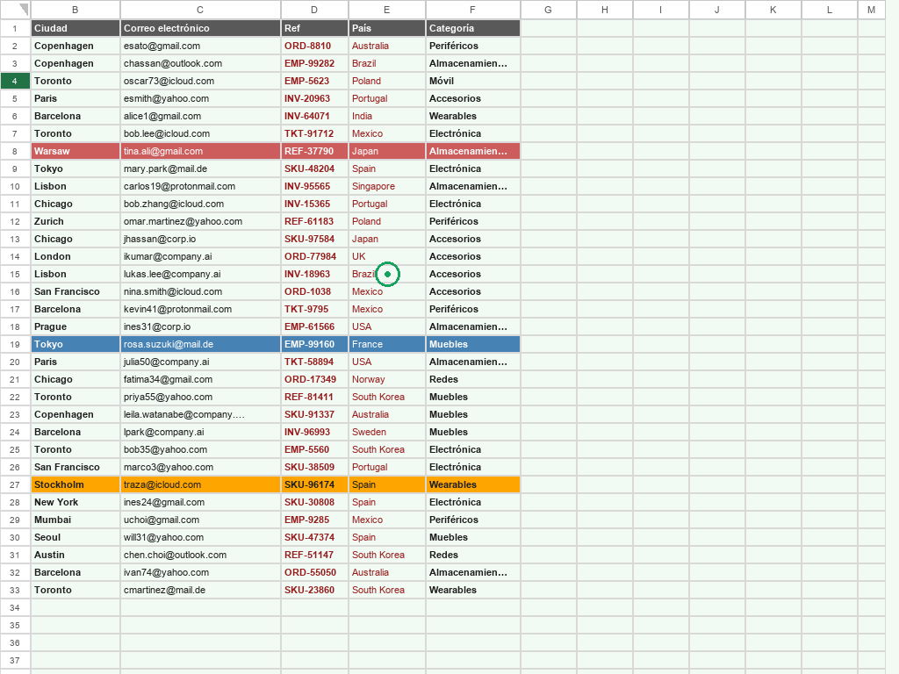
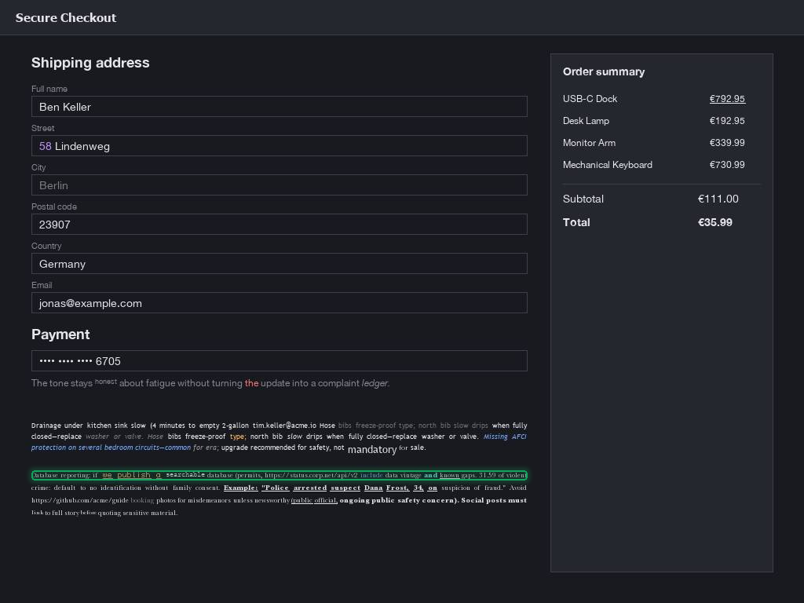
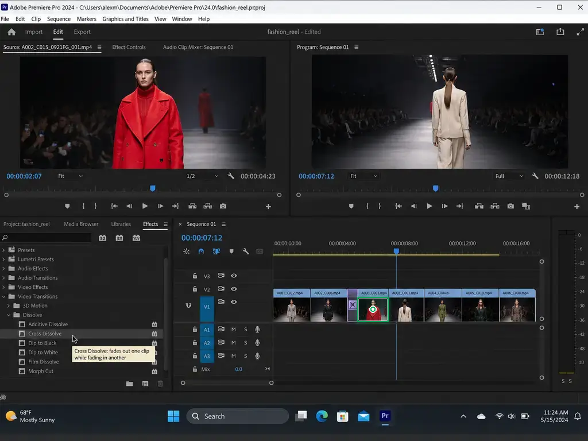

# Pointerbench

Pointerbench is a GUI grounding benchmark suite for computer-use models.

It tests a simple question: given a screenshot and an instruction, can the model point to the right place?

The dataset is hosted on Hugging Face:

https://huggingface.co/datasets/WarmwindOS/pointerbench

This GitHub repository contains the evaluation scripts, metadata files, and release notes. It does not store the PNG screenshots. Download the images from Hugging Face.

## Links

- Blog post: https://about.warmwind.com/pointer-bench/
- Dataset: https://huggingface.co/datasets/WarmwindOS/pointerbench
- Add your model to the official benchmark leaderboard: https://warmwind.com/contact

## Subsets

| Subset | Examples | What it tests |
| --- | ---: | --- |
| `pointerbench-sheets` | 500 | Spreadsheet cells, colors, headers, edges, corners, and relative positions |
| `pointerbench-text` | 500 | Words, characters, punctuation, caret positions, chrome text, text bounding boxes, and invoice fields |
| `pointerbench-pro` | 500 | Icons, text, and mixed GUI targets across 100 professional applications |

## Leaderboard

Scores are percentages. The table is ranked by the reported public average across Sheets, Text, and Pro. The Fable 5 row is a uniform 50 percent sample rerun: 250 examples per benchmark, seed 20260702. Other rows are full public report runs unless otherwise noted.

| Rank | Model | Sheets | Text | Pro | Average |
| ---: | --- | ---: | ---: | ---: | ---: |
| 1 | `anthropic/claude-fable-5` | 96.0 | 58.4 | 80.8 | 78.7 |
| 2 | `warmwind/pointer-1.6 (agentic)` | 87.8 | 66.8 | 76.8 | 77.1 |
| 3 | `anthropic/claude-sonnet-4.6` | 82.6 | 47.8 | 77.4 | 69.3 |
| 4 | `anthropic/claude-opus-4.8` | 82.2 | 44.4 | 80.2 | 68.9 |
| 5 | `warmwind/pointer-1.6` | 77.0 | 49.2 | 76.8 | 67.7 |
| 6 | `anthropic/claude-opus-4.7` | 73.8 | 36.2 | 75.4 | 61.8 |
| 7 | `openai/gpt-5.5` | 72.4 | 31.4 | 75.8 | 59.9 |
| 8 | `openai/gpt-5.4` | 63.2 | 25.0 | 50.4 | 46.2 |
| 9 | `openai/gpt-5` | 35.2 | 13.6 | 20.2 | 23.0 |
| 10 | `x-ai/grok-4.20-multi-agent` | 10.6 | 1.4 | 10.0 | 7.3 |
| 11 | `moonshotai/kimi-k2.5` | 10.8 | 3.4 | 3.0 | 5.7 |
| 12 | `openai/gpt-5-mini` | 6.0 | 1.4 | 5.8 | 4.4 |
| 13 | `moonshotai/kimi-k2.6` | 5.6 | 2.8 | 2.8 | 3.7 |
| 14 | `qwen/qwen3.7-plus` | 5.8 | 0.6 | 3.0 | 3.1 |
| 15 | `qwen/qwen3.6-flash` | 4.2 | 1.2 | 2.6 | 2.7 |
| 16 | `minimax/minimax-m3` | 3.6 | 0.4 | 3.6 | 2.5 |
| 17 | `qwen/qwen3.6-plus` | 3.0 | 0.6 | 3.6 | 2.4 |
| 18 | `qwen/qwen3-vl-235b-a22b-thinking` | 2.6 | 0.4 | 3.2 | 2.1 |
| 19 | `qwen/qwen3.5-9b` | 2.0 | 0.2 | 2.6 | 1.6 |
| 20 | `google/gemini-3.5-flash` | 3.4 | 0.6 | 0.6 | 1.5 |
| 21 | `openai/gpt-5-nano` | 2.0 | 0.2 | 1.6 | 1.3 |
| 22 | `moonshotai/kimi-k2.7-code` | 0.4 | 1.8 | 0.8 | 1.0 |
| 23 | `x-ai/grok-4.3` | 1.2 | 0.0 | 0.0 | 0.4 |
| 24 | `google/gemini-3.1-pro-preview` | 0.0 | 0.2 | 0.4 | 0.2 |
| 25 | `google/gemini-3.1-pro-preview-customtools` | 0.0 | 0.4 | 0.0 | 0.1 |
| 26 | `stepfun/step-3.7-flash` | 0.0 | 0.0 | 0.2 | 0.1 |
| 27 | `x-ai/grok-build-0.1` | 0.0 | 0.0 | 0.0 | 0.0 |
| 28 | `xiaomi/mimo-v2.5` | 0.0 | 0.0 | 0.0 | 0.0 |
| - | Center-click baseline | 0.4 | 0.2 | 0.2 | 0.3 |

To add your model to the official benchmark leaderboard, contact https://warmwind.com/contact.

All examples use 1024x768 screenshots. Each metadata row contains an instruction, target bbox, reference point, answer type, and evaluation rule.

## Examples

The green overlay marks the accepted target geometry.

<p>
  
</p>

`pointerbench-sheets`  
Prompt: `Target cell E15.`  
Expected output: `point [441, 312]`

<p>
  
</p>

`pointerbench-text`  
Prompt: `Need a tight box for the line that starts with «Database reporting: if».`  
Expected output: `bbox [40, 599, 671, 611]`

<p>
  
</p>

`pointerbench-pro`  
Prompt: `Select the red-coat clip.`  
Expected output: `point [649, 538]`

## Repository Contents

```text
pointerbench-sheets/
  eval.py
  data/test/metadata.jsonl
  REPRODUCE.md

pointerbench-text/
  eval.py
  data/test/metadata.jsonl
  REPRODUCE.md

pointerbench-pro/
  eval.py
  data/test/metadata.jsonl
  apps.json
  REPRODUCE.md
```

The GitHub repo includes metadata so you can inspect the benchmark and run scoring code. To run full evaluations, download the images from Hugging Face into the same folder layout.

## Download The Data

```bash
huggingface-cli download WarmwindOS/pointerbench \
  --repo-type dataset \
  --local-dir .
```

This creates the same folder structure used by the scorers.

## Inference Protocol

All screenshots are 1024x768. Run inference in that coordinate frame and return absolute pixel coordinates with origin at the top-left. Do not resize, crop, or normalize the coordinate frame unless you convert predictions back to 1024x768 before scoring.

Each scorer includes the recommended prompt:

```bash
python eval.py --show-system-prompt
```

Default system prompt:

```text
You are evaluating Pointerbench, a GUI grounding benchmark. You will receive one 1024x768 screenshot and one task instruction. Use absolute pixel coordinates with origin at the top-left of the image. Do not return normalized coordinates. Do not crop or resize the coordinate frame. For point tasks, return JSON like {"point": [x, y]}. For bounding-box tasks, return JSON like {"bbox": [x0, y0, x1, y1]}.
```

You can edit this prompt for your inference stack. Keep the coordinate frame and output format fixed, and report any image resizing or multi-step zoom strategy with your results.

## Prediction Format

Predictions are JSONL. Use one row per example.

Point examples:

```json
{"id": "pbs_0001", "point": [100, 151]}
```

Bbox examples:

```json
{"id": "pbt_0002", "bbox": [306, 560, 340, 579]}
```

Point tasks are correct when the predicted point lands inside the target bbox.
Bbox tasks (Pointerbench-Text) use an asymmetric overlap rule: a hit requires the
ground truth to be almost fully covered (coverage >= 0.90) and the prediction to
stay reasonably tight around it (precision >= 0.70). This penalises predictions
that cut off part of the target far more than predictions that wrap it with some
margin.

## Evaluate

Run the scorer from the subset folder:

```bash
cd pointerbench-sheets
python eval.py --predictions preds.jsonl
```

```bash
cd pointerbench-text
python eval.py --predictions preds.jsonl
```

```bash
cd pointerbench-pro
python eval.py --predictions preds.jsonl
```

Each scorer uses only the Python standard library.

## License

Dataset images and annotations are released under CC BY 4.0.
The included evaluation scripts are released under MIT.
