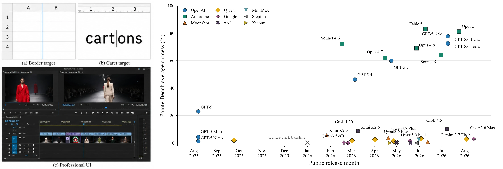

# PointerBench

[](https://arxiv.org/abs/2610.31274) [](https://sites.google.com/view/aaba4et) [](https://github.com/warmwindOS/pointerbench) [](https://huggingface.co/datasets/WarmwindOS/pointerbench)

Official repository for the paper **"PointerBench: A Diagnostic Benchmark for Fine-Grained GUI Grounding"**, accepted at the [2nd Workshop on Agentic AI Benchmarks and Applications for Enterprise Tasks](https://sites.google.com/view/aaba4et).



Pointerbench is a GUI grounding benchmark suite for computer-use models.

It tests a simple question: given a screenshot and an instruction, can the model point to the right place?

The dataset is hosted on Hugging Face:

https://huggingface.co/datasets/WarmwindOS/pointerbench

This GitHub repository contains the evaluation scripts, metadata files, and release notes. It does not store the PNG screenshots. Download the images from Hugging Face.

## Links

- Workshop: https://sites.google.com/view/aaba4et
- Blog post: https://about.warmwind.com/pointer-bench/
- Dataset: https://huggingface.co/datasets/WarmwindOS/pointerbench
- Add your model to the official benchmark leaderboard: https://warmwind.com/contact

## Subsets

| Subset | Examples | What it tests |
| --- | ---: | --- |
| `pointerbench-sheets` | 500 | Spreadsheet cells, colors, headers, edges, corners, and relative positions |
| `pointerbench-text` | 500 | Words, characters, punctuation, caret positions, chrome text, text bounding boxes, and invoice fields |
| `pointerbench-pro` | 500 | Icons, text, and mixed GUI targets across 100 professional applications |

## Leaderboard

Scores are percentages. The frontier table is ranked by the average across Sheets, Text, and Pro. Previously published rows keep their reported public scores, including `warmwind/pointer-1.6 (agentic)`. GPT-6 Astra, Claude Opus 5.5, Claude Fable 5.1, Claude Sonnet 5.5, Claude Opus 5, Claude Sonnet 5, Grok 4.5, Grok 4.20, Gemini 4 Argon, Gemini 3.7 Flash, and Qwen3.8 Max are the official paper runs.

### Frontier models

| Rank | Model | Sheets | Text | Pro | Average |
| ---: | --- | ---: | ---: | ---: | ---: |
| 1 | `openai/gpt-6-astra` | 99.6 | 84.8 | 81.8 | 88.7 |
| 2 | `anthropic/claude-opus-5.5` | 98.2 | 76.4 | 82.6 | 85.7 |
| 3 | `anthropic/claude-fable-5.1` | 96.4 | 76.4 | 83.4 | 85.4 |
| 4 | `anthropic/claude-sonnet-5.5` | 95.8 | 73.6 | 82.0 | 83.8 |
| 5 | `anthropic/claude-opus-5` | 98.8 | 63.2 | 81.2 | 81.1 |
| 6 | `anthropic/claude-fable-5` | 96.0 | 58.4 | 80.8 | 78.7 |
| 7 | `warmwind/pointer-1.6 (agentic)` | 87.8 | 66.8 | 76.8 | 77.1 |
| 8 | `anthropic/claude-sonnet-4.6` | 82.6 | 47.8 | 77.4 | 69.3 |
| 9 | `anthropic/claude-opus-4.8` | 82.2 | 44.4 | 80.2 | 68.9 |
| 10 | `openai/gpt-5.6-sol-pro` | 92.0 | 32.0 | 72.0 | 65.3 |
| 11 | `openai/gpt-5.6-sol` | 92.0 | 30.0 | 74.0 | 65.3 |
| 12 | `anthropic/claude-sonnet-5` | 78.6 | 36.0 | 77.0 | 63.9 |
| 13 | `anthropic/claude-opus-4.7` | 73.8 | 36.2 | 75.4 | 61.8 |
| 14 | `openai/gpt-5.5` | 72.4 | 31.4 | 75.8 | 59.9 |
| 15 | `openai/gpt-5.6-terra-pro` | 52.0 | 20.0 | 74.0 | 48.7 |
| 16 | `openai/gpt-5.6-terra` | 50.0 | 22.0 | 70.0 | 47.3 |
| 17 | `openai/gpt-5.4` | 63.2 | 25.0 | 50.4 | 46.2 |
| 18 | `openai/gpt-5.6-luna` | 56.0 | 20.0 | 60.0 | 45.3 |
| 19 | `openai/gpt-5.6-luna-pro` | 54.0 | 18.0 | 62.0 | 44.7 |
| 20 | `openai/gpt-5` | 35.2 | 13.6 | 20.2 | 23.0 |
| 21 | `x-ai/grok-4.5` | 15.2 | 1.4 | 14.0 | 10.2 |
| 22 | `x-ai/grok-4.20` | 13.4 | 1.0 | 11.6 | 8.7 |
| 23 | `x-ai/grok-4.20-multi-agent` | 10.6 | 1.4 | 10.0 | 7.3 |
| 24 | `moonshotai/kimi-k2.5` | 10.8 | 3.4 | 3.0 | 5.7 |
| 25 | `openai/gpt-5-mini` | 6.0 | 1.4 | 5.8 | 4.4 |
| 26 | `google/gemini-4-argon` | 7.0 | 1.4 | 4.2 | 4.2 |
| 27 | `moonshotai/kimi-k2.6` | 5.6 | 2.8 | 2.8 | 3.7 |
| 28 | `qwen/qwen3.7-plus` | 5.8 | 0.6 | 3.0 | 3.1 |
| 29 | `google/gemini-3.7-flash` | 4.0 | 1.2 | 4.2 | 3.1 |
| 30 | `qwen/qwen3.8-max` | 4.8 | 0.2 | 3.4 | 2.8 |
| 31 | `qwen/qwen3.6-flash` | 4.2 | 1.2 | 2.6 | 2.7 |
| 32 | `minimax/minimax-m3` | 3.6 | 0.4 | 3.6 | 2.5 |
| 33 | `qwen/qwen3.6-plus` | 3.0 | 0.6 | 3.6 | 2.4 |
| 34 | `qwen/qwen3-vl-235b-a22b-thinking` | 2.6 | 0.4 | 3.2 | 2.1 |
| 35 | `qwen/qwen3.5-9b` | 2.0 | 0.2 | 2.6 | 1.6 |
| 36 | `google/gemini-3.5-flash` | 3.4 | 0.6 | 0.6 | 1.5 |
| 37 | `openai/gpt-5-nano` | 2.0 | 0.2 | 1.6 | 1.3 |
| 38 | `moonshotai/kimi-k2.7-code` | 0.4 | 1.8 | 0.8 | 1.0 |
| 39 | `x-ai/grok-4.3` | 1.2 | 0.0 | 0.0 | 0.4 |
| 40 | `google/gemini-3.1-pro-preview` | 0.0 | 0.2 | 0.4 | 0.2 |
| 41 | `google/gemini-3.1-pro-preview-customtools` | 0.0 | 0.4 | 0.0 | 0.1 |
| 42 | `stepfun/step-3.7-flash` | 0.0 | 0.0 | 0.2 | 0.1 |
| 43 | `x-ai/grok-build-0.1` | 0.0 | 0.0 | 0.0 | 0.0 |
| 44 | `xiaomi/mimo-v2.5` | 0.0 | 0.0 | 0.0 | 0.0 |
| - | Center-click baseline | 0.4 | 0.2 | 0.2 | 0.3 |

### Specialist models

Specialist GUI grounding models on the same three suites. `warmwind/pointer-1.6` and `warmwind/pointer-1.5-light` are the 0–1000 runs, scored with the official evaluators.

| Rank | Model | Sheets | Text | Pro | Average |
| ---: | --- | ---: | ---: | ---: | ---: |
| 1 | `warmwind/pointer-1.6` | 73.0 | 37.4 | 75.6 | 62.0 |
| 2 | MVP Qwen3-VL-32B | 68.4 | 34.0 | 75.4 | 59.3 |
| 3 | `warmwind/pointer-1.5-light` | 63.4 | 31.0 | 74.2 | 56.2 |
| 4 | GTA1-32B | 65.0 | 29.6 | 70.2 | 54.9 |
| 5 | UI-Venus-2-9B | 64.2 | 25.8 | 73.6 | 54.5 |
| 6 | MAI-UI-8B | 59.2 | 23.2 | 71.6 | 51.3 |
| 7 | MVP Qwen3-VL-8B | 60.4 | 22.4 | 70.8 | 51.2 |
| 8 | UI-Venus-1.5-8B | 56.4 | 23.8 | 72.8 | 51.0 |
| 9 | OpenCUA-32B | 66.0 | 19.4 | 67.4 | 50.9 |
| 10 | Qwen3-VL-32B-Instruct | 58.8 | 23.8 | 69.6 | 50.7 |
| 11 | ScaleCUA-32B | 57.4 | 27.4 | 66.8 | 50.5 |
| 12 | GTA1-7B | 60.2 | 22.8 | 67.4 | 50.1 |
| 13 | OpenCUA-7B | 59.8 | 18.4 | 63.8 | 47.3 |
| 14 | MVP UI-TARS-1.5-7B | 50.6 | 26.8 | 62.6 | 46.7 |
| 15 | UI-Venus-Ground-7B | 47.8 | 24.6 | 66.2 | 46.2 |
| 16 | ScaleCUA-7B | 51.6 | 22.0 | 63.6 | 45.7 |
| 17 | GUI-G2-7B | 45.8 | 21.6 | 64.6 | 44.0 |
| 18 | UI-Ins-32B | 44.0 | 24.0 | 62.8 | 43.6 |
| 19 | Qwen3-VL-8B-Instruct | 48.2 | 14.6 | 65.8 | 42.9 |
| 20 | UI-Ins-7B | 42.6 | 22.0 | 62.2 | 42.3 |
| 21 | Jedi-7B-1080p | 47.4 | 20.4 | 57.2 | 41.7 |
| 22 | UI-TARS-1.5-7B | 46.2 | 18.2 | 57.4 | 40.6 |
| 23 | InfiGUI-G1-7B | 41.0 | 18.6 | 59.2 | 39.6 |
| 24 | SE-GUI-7B | 40.2 | 20.2 | 53.4 | 37.9 |
| 25 | GUI-RC UI-TARS-1.5-7B | 45.6 | 15.6 | 51.4 | 37.5 |
| 26 | ScaleCUA-3B | 36.4 | 17.2 | 58.0 | 37.2 |
| 27 | Jedi-3B-1080p | 37.0 | 16.8 | 57.6 | 37.1 |
| 28 | Rex-Omni-3B | 43.6 | 17.6 | 49.4 | 36.9 |
| 29 | MAI-UI-2B | 36.6 | 9.8 | 61.0 | 35.8 |
| 30 | GUI-G2-3B | 29.6 | 19.2 | 57.8 | 35.5 |
| 31 | FocusUI-7B | 32.8 | 12.4 | 56.0 | 33.7 |
| 32 | UGround-V1-7B | 36.8 | 13.6 | 50.6 | 33.7 |
| 33 | GUI-Actor-7B | 35.6 | 11.0 | 53.6 | 33.4 |
| 34 | GUI-Spotlight-7B | 34.4 | 11.8 | 53.6 | 33.3 |
| 35 | GUI-AIMA-3B | 33.6 | 9.2 | 56.8 | 33.2 |
| 36 | GUI-Actor-3B | 32.6 | 11.4 | 50.6 | 31.5 |
| 37 | InfiGUI-G1-3B | 23.2 | 15.2 | 53.6 | 30.7 |
| 38 | FocusUI-3B | 27.0 | 11.2 | 51.8 | 30.0 |
| 39 | FocusUI-Qwen3-VL-2B | 27.8 | 9.0 | 51.0 | 29.3 |
| 40 | UGround-V1-2B | 27.0 | 9.6 | 45.0 | 27.2 |
| 41 | SE-GUI-3B | 19.2 | 7.8 | 48.8 | 25.3 |

To add your model to the official benchmark leaderboard, contact https://warmwind.com/contact.

All examples use 1024x768 screenshots. Each metadata row contains an instruction, target bbox, reference point, answer type, and evaluation rule.

## Examples

The green overlay marks the accepted target geometry.

<p>
  
</p>

`pointerbench-sheets`  
Prompt: `Target cell E15.`  
Expected output: `point [441, 312]`

<p>
  
</p>

`pointerbench-text`  
Prompt: `Need a tight box for the line that starts with «Database reporting: if».`  
Expected output: `bbox [40, 599, 671, 611]`

<p>
  
</p>

`pointerbench-pro`  
Prompt: `Select the red-coat clip.`  
Expected output: `point [649, 538]`

## Repository Contents

```text
pointerbench-sheets/
  eval.py
  data/test/metadata.jsonl
  REPRODUCE.md

pointerbench-text/
  eval.py
  data/test/metadata.jsonl
  REPRODUCE.md

pointerbench-pro/
  eval.py
  data/test/metadata.jsonl
  apps.json
  REPRODUCE.md
```

The GitHub repo includes metadata so you can inspect the benchmark and run scoring code. To run full evaluations, download the images from Hugging Face into the same folder layout.

## Download The Data

```bash
huggingface-cli download WarmwindOS/pointerbench \
  --repo-type dataset \
  --local-dir .
```

This creates the same folder structure used by the scorers.

## Inference Protocol

All screenshots are 1024x768. Run inference in that coordinate frame and return absolute pixel coordinates with origin at the top-left. Do not resize, crop, or normalize the coordinate frame unless you convert predictions back to 1024x768 before scoring.

Each scorer includes the recommended prompt:

```bash
python eval.py --show-system-prompt
```

Default system prompt:

```text
You are evaluating Pointerbench, a GUI grounding benchmark. You will receive one 1024x768 screenshot and one task instruction. Use absolute pixel coordinates with origin at the top-left of the image. Do not return normalized coordinates. Do not crop or resize the coordinate frame. For point tasks, return JSON like {"point": [x, y]}. For bounding-box tasks, return JSON like {"bbox": [x0, y0, x1, y1]}.
```

You can edit this prompt for your inference stack. Keep the coordinate frame and output format fixed, and report any image resizing or multi-step zoom strategy with your results.

## Prediction Format

Predictions are JSONL. Use one row per example.

Point examples:

```json
{"id": "pbs_0001", "point": [100, 151]}
```

Bbox examples:

```json
{"id": "pbt_0002", "bbox": [306, 560, 340, 579]}
```

Point tasks are correct when the predicted point lands inside the target bbox.
Bbox tasks (Pointerbench-Text) use an asymmetric overlap rule: a hit requires the
ground truth to be almost fully covered (coverage >= 0.90) and the prediction to
stay reasonably tight around it (precision >= 0.70). This penalises predictions
that cut off part of the target far more than predictions that wrap it with some
margin.

## Evaluate

Run the scorer from the subset folder:

```bash
cd pointerbench-sheets
python eval.py --predictions preds.jsonl
```

```bash
cd pointerbench-text
python eval.py --predictions preds.jsonl
```

```bash
cd pointerbench-pro
python eval.py --predictions preds.jsonl
```

Each scorer uses only the Python standard library.

## License

Dataset images and annotations are released under CC BY 4.0.
The included evaluation scripts are released under MIT.
